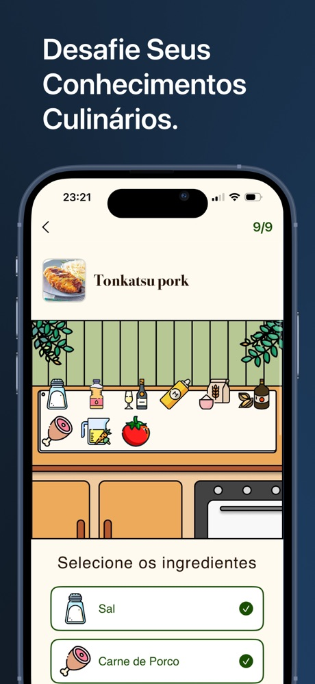
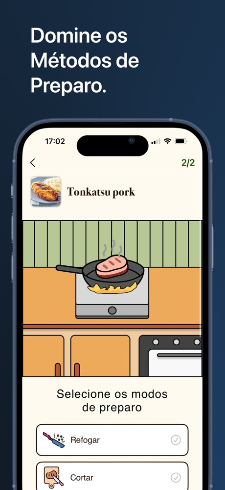

<div align="center">


# Sabour

**Aprenda a cozinhar jogando.**

Jogo de culinária para iPhone em que você escolhe uma cozinha do mundo, recebe um prato e
precisa acertar os ingredientes e os modos de preparo. No fim, ganha a nota, a receita
completa e o vídeo de como fazer.

[](https://apps.apple.com/br/app/sabour/id6746773198)


</div>


> [!NOTE]
> Projeto **solo**, do design à publicação, feito na Apple Developer Academy | UCB e
> disponível na App Store.

---

## ✨ O que ele faz

| | |
|---|---|
| 🌍 **Cozinhas do mundo** | Japonesa, francesa, mexicana e italiana, cada uma com trilha sonora própria |
| 🧂 **Escolha os ingredientes** | Uma bancada ilustrada; acerte o que vai no prato |
| 🍳 **Modos de preparo** | Refogar, cortar, empanar, fritar... a cena da cozinha muda conforme a etapa |
| 🏆 **Nota da receita** | Pontuação de 0 a 100 com mensagens que mudam pelo desempenho, e o tempo da partida |
| 📖 **Receita completa** | Ingredientes certos e errados, passo a passo e vídeo do YouTube dentro do app |
| ❤️ **Favoritos** | Salve receitas para rever depois, mesmo fora do jogo |
| 💡 **Dicas contextuais** | Onboarding e dicas com TipKit na primeira vez em cada tela |
| 🔊 **Som e animação** | Efeitos sonoros em cada interação e animações Lottie |

## 📸 Telas

<table>
  <tr>
    <td width="20%"><br/><sub><b>Abertura</b></sub></td>
    <td width="20%"><br/><sub><b>Livro de culturas</b>: escolha a cozinha</sub></td>
    <td width="20%"><br/><sub><b>Ingredientes</b>: monte o prato</sub></td>
    <td width="20%"><br/><sub><b>Preparo</b>: escolha as técnicas</sub></td>
    <td width="20%"><br/><sub><b>Resultado</b>: acertos, erros e vídeo</sub></td>
  </tr>
</table>

## 🧱 Estrutura

```
Sabour/
├── App/            ponto de entrada (SabourApp)
├── Models/         receitas, ingredientes, modos de preparo, resposta da API, traduções
├── ViewModels/     estado global, timer da partida, favoritos, sons, dicas (TipKit), MealService
├── Views/
│   ├── HomeComponents/   livro de culturas, páginas, onboarding
│   └── GameComponents/   ingredientes, preparo, análise e imagem ampliada
├── MusicAndSounds/ trilhas por cozinha e efeitos de interface
└── Animations/     animações Lottie
```

- **MVVM com `ObservableObject`**: `GameTimerManager`, `GlobalAppState` e `FavoritesManager`
  são injetados como `EnvironmentObject`.
- **Rede com `async/await`**: `MealService` busca o prato na TheMealDB pelo nome.
- **Persistência leve**: favoritos em `UserDefaults`, codificados em JSON.

## 🚀 Primeiros passos

```bash
git clone https://github.com/daniellealpimenta/Sabour.git
open Sabour/Sabour.xcodeproj
```

Escolha o seu time em *Signing & Capabilities* e rode (iOS 18.4+). As dependências
(dotLottie) são baixadas pelo Swift Package Manager na primeira abertura.

## 🆘 Suporte

[Página de suporte](https://daniellealpimenta.github.io/Sabour/suport): dúvidas, bugs e sugestões.

## 🗺️ Roadmap

- [x] Quatro cozinhas, pontuação e receita completa
- [x] Favoritos, TipKit e trilha sonora por cozinha
- [x] Publicação na App Store
- [ ] Novas cozinhas (brasileira, indiana, chinesa)
- [ ] Ranking no Game Center
- [ ] Localização em inglês

<details>
<summary>🇺🇸 <b>English summary</b></summary>

**Sabour** is a cooking game for iPhone, built solo in SwiftUI and available on the
[App Store](https://apps.apple.com/br/app/sabour/id6746773198). Pick a cuisine (Japanese,
French, Mexican or Italian), get a dish and choose the right ingredients and cooking methods.
You get a 0–100 score, the full recipe and a how-to video. Built with SwiftUI, Combine,
TipKit, dotLottie and TheMealDB API.

</details>

## 👤 Autor

**Daniel Leal Pimenta** · [GitHub](https://github.com/daniellealpimenta) ·
[LinkedIn](https://www.linkedin.com/in/daniel-leal-pimenta)

## ⚖️ Licença

Código disponível apenas para portfólio e demonstração. Uso comercial depende de autorização
do autor. Veja [`LICENSE`](LICENSE).
